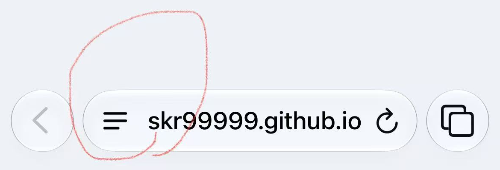
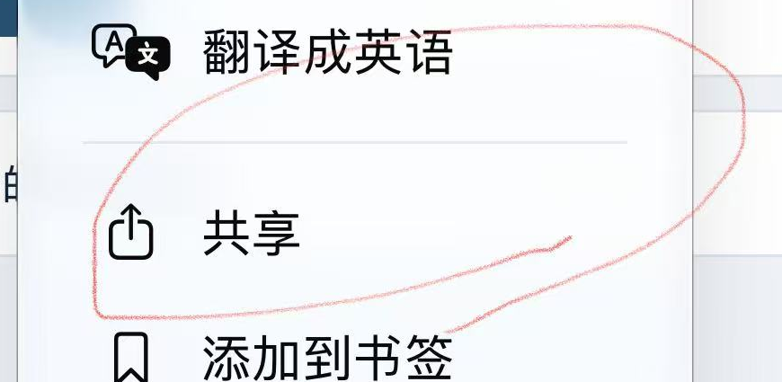
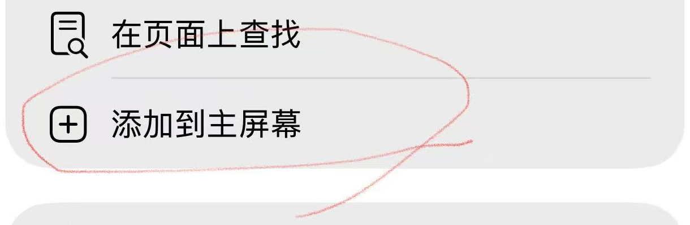
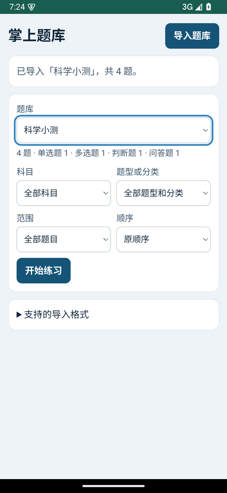
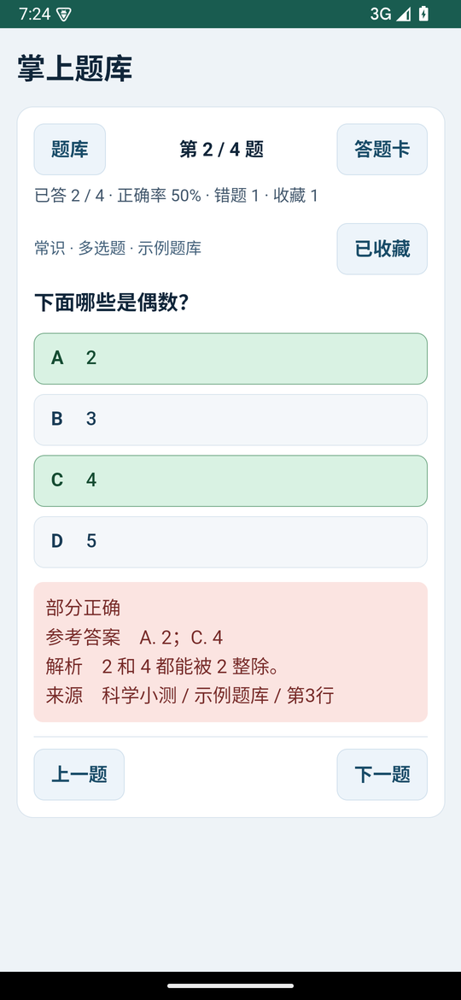
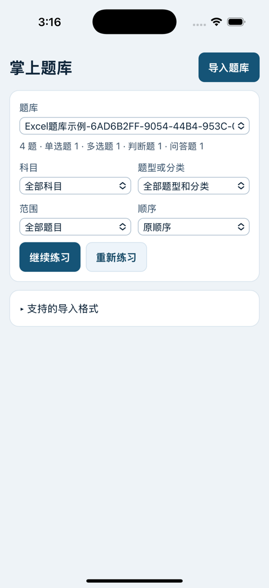

# 掌上题库 · QuizPocket

**[打开掌上题库网页版](https://skr99999.github.io/QuizPocket/)** · [添加到手机主屏幕（图解）](#把网页版加到手机桌面)

用手机浏览器打开就能刷题，也可以把网页版加到手机主屏幕。首次联网完成离线准备后，断网也能导入 Word、Excel 题库，继续做题或复习错题。题库和练习记录保存在本机。Android 和 iPhone 原生 App 均可下载，首次启动即可离线使用。

**[下载安卓安装包](https://github.com/skr99999/QuizPocket/releases/latest/download/QuizPocket.apk)** · **[下载 iPhone 安装包（需签名）](https://github.com/skr99999/QuizPocket/releases/download/ios-v1.0.0-r1/QuizPocket-unsigned.ipa)** · [Excel 题库模板](templates/Excel题库示例.xlsx) · [Word 题库模板](templates/Word题库示例.docx)

## 把网页版加到手机桌面

### iPhone Safari

1. 在 Safari 打开[掌上题库网页版](https://skr99999.github.io/QuizPocket/)，点底部地址栏左侧的横线菜单。

   

2. 在弹出的菜单里点「共享」。如果工具栏上直接显示共享按钮，也可以点那个按钮。

   

3. 在共享菜单中向下滑，点「添加到主屏幕」。如果看不到这项，滑到列表底部，在「编辑操作」里添加它。

   

4. 如果有「作为网页 App 打开」开关，打开它，再点右上角的「添加」。保持联网，从主屏幕点「掌上题库」图标。页面显示「已可离线使用」后，就可以断网打开、导入和练习。

[Apple 中文指南：在 iPhone 上将网站变为 App](https://support.apple.com/zh-cn/guide/iphone/iphea86e5236/26/ios/26)

### Android 浏览器

在 Chrome 等浏览器打开网页版，从右上角菜单选「添加到主屏幕」或「安装应用」。菜单名称随浏览器而异。添加后保持联网，从主屏幕点图标打开一次，等页面显示「已可离线使用」。

### 导入自己的题库

在微信或 QQ 收到 Word、Excel 题库时，先把附件存到「文件」或下载目录，再回网页版点「导入题库」选取。网页版和原生 App 各自保存题库与练习记录，切换版本时可用原文件重新导入。

## 让 Agent 安装掌上题库

点下方代码块右上角的复制按钮，把整段发给能操作你电脑或手机的 Agent。

```text
请帮我在手机上用掌上题库（QuizPocket），并确认能打开题库首页。
官方仓库 https://github.com/skr99999/QuizPocket
发布列表 https://github.com/skr99999/QuizPocket/releases
查看 README，识别电脑系统和目标手机。遇到没连上设备或有多台候选，只请我做必要的确认。

如果我要在 Safari 或浏览器打开，或者要把网页版加到手机桌面，使用 https://skr99999.github.io/QuizPocket/ 。
iPhone 在 Safari 点「分享」→「添加到主屏幕」，有「作为网页 App 打开」时开启。Android 在浏览器菜单选「添加到主屏幕」或「安装应用」。
从桌面图标联网打开一次，等页面提示可离线使用。请回报链接、桌面图标和离线验证做到哪一步，再结束网页版流程。

如果我明确要求安装原生 App，按目标平台选最新正式发行版。用该发行版附件的 SHA-256 校验下载文件，不匹配就停止。
• Android：下载 QuizPocket.apk，入口为 https://github.com/skr99999/QuizPocket/releases/latest/download/QuizPocket.apk
  已连接且授权 ADB 时，用 adb -s <设备序列号> install -r <APK路径>。没有 ADB 时，将官方链接给我在手机上安装。
• iPhone：先查官方 README 是否已有 App Store 或 TestFlight 入口，有就优先使用。
  需要侧载时，在发布列表里找最新正式 iOS 版的 QuizPocket-unsigned.ipa。可从
  https://github.com/skr99999/QuizPocket/releases/tag/ios-v1.0.0-r1 定位当前修订版。
  有更新的正式 iOS 版时选新版。GitHub 的 Latest 标记可能指向 Android 版。
  Windows 检查 C 盘可用空间，即使临时目录在别的盘，AltServer 也会用到 C 盘。
  解锁并连接 iPhone，按住 Shift 点击托盘里的 AltServer，选「Sideload .ipa…」和目标设备。
  直接用发布的未签名 IPA。Apple 账号、验证码、电脑或开发者信任、开发者模式由我在自己的设备上操作。免费账号通常每七天续签一次。
  Mac 可打开仓库里的 iOS 工程，用 Xcode 选择我的 Team 和 iPhone 后运行。

保留已有题库和练习记录。更新时沿用原来的标识和签名身份，遇到签名冲突、需要撤销证书或卸载时先问我。
安装后查手机上的应用和版本，再打开「掌上题库」确认能进入题库首页。看不到手机屏幕时请我确认。
回报平台、版本、真机安装与首页验证结果。还在下载、签名或等待我操作时，说清目前做到哪一步。
```

| 导入后核对题数 | 多选题提交后查看反馈 | 用答题卡跳题 |
| :---: | :---: | :---: |
|  |  |  |

截图来自 Android 15 模拟器，题目取自仓库里的 Excel 模板。

## 在 iPhone 上安装

iPhone 版是独立 App，支持 iOS 17 及以上。安装后直接从桌面打开，首次启动就能离线练习。已有的 Word、Excel 或旧 HTML 题库可以继续使用。

- **用 Windows 安装 IPA**。从 [iPhone 修订版发布页](https://github.com/skr99999/QuizPocket/releases/tag/ios-v1.0.0-r1) 下载 [QuizPocket-unsigned.ipa](https://github.com/skr99999/QuizPocket/releases/download/ios-v1.0.0-r1/QuizPocket-unsigned.ipa)，与该发行版附件的 SHA-256 核对。IPA 还未签名。修订版将签名时使用的名称设为 `QuizPocket`，简体中文系统仍可显示「掌上题库」。下载后直接用 AltServer 签名即可。
  1. 在 Windows 上安装 AltServer，检查 C 盘有可用空间。即使把临时目录设在其他盘，AltServer 仍会写入 C 盘。用 USB 连接并解锁 iPhone，按手机提示信任电脑。
  2. 按住 Shift 点击系统托盘里的 AltServer 图标，选择「Sideload .ipa…」、目标 iPhone 和下载的 IPA，在本机窗口用自己的 Apple 账号签名。按手机提示开启开发者模式并信任开发者。免费账号签名通常每七天续签一次。
  3. 安装结束后在 iPhone 上找「掌上题库」或「QuizPocket」，打开并确认能进入题库首页。更新或续签时沿用原签名身份和应用标识。遇到签名冲突，先保留手机上的现有应用，以免丢失题库和练习记录。

  [AltServer 安装指南](https://faq.altstore.io/altstore-classic/how-to-install-altstore-windows) · [IPA 侧载说明](https://faq.altstore.io/release-notes/altserver)
- **用 Mac 和 Xcode 安装**。打开 [iOS 工程](ios/QuizPocket.xcodeproj)，在 Signing & Capabilities 选择自己的 Team 和可用的 Bundle Identifier，选中连接的 iPhone 后运行。[Apple 真机运行指南](https://developer.apple.com/documentation/xcode/running-your-app-on-simulated-or-physical-devices)
- **导入聊天附件**。在微信或 QQ 将附件「存储到文件」，再从 App 点「导入题库」选择。系统向 App 交付支持的题库文档时，也能通过「打开方式」接收。各聊天客户端的菜单和可选目标可能不同。



这张截图来自 iOS 18.5 模拟器。模拟器已验证 App 启动、Excel 文件 URL 导入、去重，以及重新载入后恢复到第 2 题。本次发布的 IPA 已通过 AltServer 签名并安装到实体 iPhone，USB 回读版本为 1.0（构建号 1）。真机首页和微信、QQ 文件交接尚未确认。[查看模拟器验收记录](https://github.com/skr99999/QuizPocket/actions/runs/44979372643)

## 在 Android 上使用

1. 在安卓手机上下载并安装 APK。想先看看答题效果，可以直接打开内置的「体验题库」。
2. 有自己的题库时，点右上角「导入题库」，从系统文件选择器选取文件。收到微信或 QQ 附件时，也可以在附件菜单中找「分享」或「用其他应用打开」，选择「掌上题库」。若菜单没有这个入口，先将附件保存到手机的下载目录，再从 App 导入。
3. 核对导入后的总题数和题型统计。有待核题目时，展开提示查看原因，例如标准答案含有 E，而原表只有 A–D。修正原文件后可重新导入。
4. 选择科目、题型、范围和顺序，点「开始练习」。中途退出后，重新打开同一题库，点「继续练习」即可回到上次的位置。

## 怎样整理题目

| 文件 | 建议格式 |
| --- | --- |
| Excel（.xlsx、.xls） | 每题一行。使用「题干」「答案」等列名，每个选项单独一列，可以附上题型、分类和解析。文件含多个工作表时会分别读取。 |
| Word（.docx） | 支持带表头的题目表格，也支持按题号排列的段落。段落题建议让题干、选项和答案各占一行。老式 .doc 可在 Word 或 WPS 中另存为 .docx。 |
| CSV | 使用 UTF-8 编码，表头至少包含「题型」「题干」「答案」。选项列可命名为 A 至 F，多选答案可写成 AC。 |
| JSON / 旧刷题 HTML | JSON 使用题目对象数组。兼容的旧 HTML 需内含 id 为 bank-data 的 JSON 数据块。导入时只读取题目数据。 |

两个模板各有单选、多选、判断、问答四道例题，适合复制后改写。扫描件、图片里的题目或只有排版而没有可提取文字的文档，需要先转成文字。单个导入文件上限为 32 MB。

## 作答与复习

- **单选和判断**点选后立即判分。答对会自动进入下一题，答错会停留，方便核对答案和已有解析。
- **多选**可以反复勾选，点「提交答案」后才判分。比如标准答案是 A、C，只选 A 会显示「部分正确」，选入 B 则判错。两种情况都计入错题。
- **问答**可以先写下自己的答案，再查看参考答案，自评答对或答错。
- **答题卡**显示当前练习范围。绿色代表答对，红色代表答错或部分正确，灰色代表未做。点题号可直接跳转。
- **错题和收藏**可以单独组成一轮练习。不同题库分别保存进度，在同一台手机上重复导入同名且内容一致的题库，会继续使用已有记录。

## 设备与数据

安卓版最低安装版本为 Android 8.0（API 26），界面使用系统 WebView，建议保持更新。已在 Android 15 模拟器验证本地文件选择、系统分享接收及重启续做。微信和 QQ 的菜单会随客户端版本变化，尚未在两款客户端中做真机验证。

Android 版没有申请联网权限；iPhone 版从应用包中读取界面资源。两端均在手机上解析文件。题库和答题记录保存在应用本地，卸载或清除应用数据会删除这些记录。请保留原始题库文件，方便以后重新导入。

## 从源码构建

iPhone 使用 [Xcode 工程](ios/QuizPocket.xcodeproj)。在 Mac 上打开项目，选择一个 iPhone 模拟器，按 ⌘R 运行或按 ⌘U 测试。从源码生成设备 IPA 的完整命令见 [iPhone 构建工作流](.github/workflows/iphone.yml)。

Android 构建脚本适用于 Windows。准备 Python 3、JDK 17、Android SDK Platform 35 和 Build Tools 35.0.0，将 JAVA_HOME 指向 JDK。在项目根目录用 PowerShell 执行（将路径换成本机的 SDK 目录）：

```powershell
$sdk = "$env:LOCALAPPDATA\Android\Sdk"
python build.py "$sdk\build-tools\35.0.0" "$sdk\platforms\android-35"
```

输出文件为 QuizPocket.apk。脚本会在当前用户的 .android 目录中生成本地构建用签名密钥。使用另一个密钥构建的 APK 无法直接覆盖已安装的签名版本。

若要运行导入和判题自检，使用 Node.js 22 或更高版本：

```powershell
node --test tests/bank.test.cjs tests/office.test.cjs
```

Android 文件选择、分享接收和 WebView 容器位于 [QuizActivity.java](src/net/quizpocket/app/QuizActivity.java)。离线界面、导入解析和判题逻辑位于 [assets](assets)。

## 许可

项目自有代码与示例采用 [MIT 许可证](LICENSE)。随包分发的 Office 解析库各自保留原许可证：[SheetJS](assets/LICENSE-SheetJS.txt)、[Mammoth](assets/LICENSE-Mammoth.txt)。
