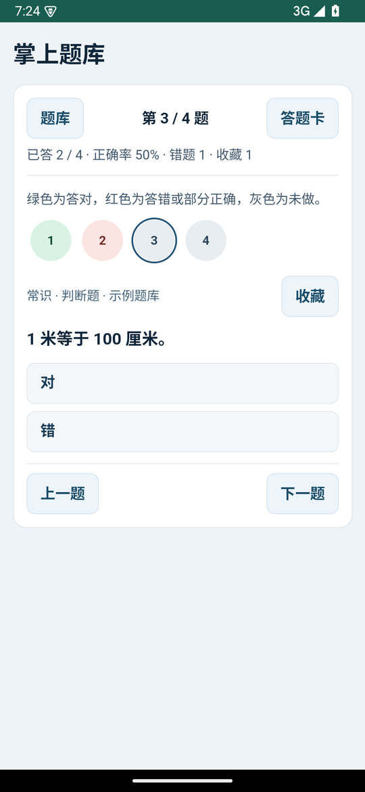

# 掌上题库 · QuizPocket

把手里的 Word 题单或 Excel 表格变成一套可以在 Android 或 iPhone 上反复练习的题库。导入后可以按科目练习、随机抽题、收藏难题，也可以专门复习上次做错的题。文件解析和答题记录都在手机上完成。应用首次启动就能离线使用。

**[下载安卓安装包](https://github.com/skr99999/QuizPocket/releases/latest/download/QuizPocket.apk)** · [Excel 题库模板](templates/Excel题库示例.xlsx) · [Word 题库模板](templates/Word题库示例.docx)

| 导入后核对题数 | 多选题提交后查看反馈 | 用答题卡跳题 |
| :---: | :---: | :---: |
|  |  |  |

截图来自 Android 15 模拟器，题目取自仓库里的 Excel 模板。

## 在 iPhone 上安装

iPhone 版是独立 App，支持 iOS 17 及以上。安装后直接从桌面打开，首次启动就能离线练习。已有的 Word、Excel 或旧 HTML 题库可以继续使用。

- **用 Windows 安装 IPA**。从 [iPhone 版本发布页](https://github.com/skr99999/QuizPocket/releases/tag/ios-v1.0.0) 下载 QuizPocket-unsigned.ipa。在自己的 Windows 电脑上配置 AltServer，连接并信任 iPhone。按住 Shift 点击系统托盘里的 AltServer 图标，选择「Sideload .ipa…」，选取 IPA 和设备，使用自己的 Apple 账号签名。依设备提示开启开发者模式及信任开发者。使用免费个人签名通常需要每七天重新签名。[AltServer 安装指南](https://faq.altstore.io/altstore-classic/how-to-install-altstore-windows) · [IPA 侧载说明](https://faq.altstore.io/release-notes/altserver)
- **用 Mac 和 Xcode 安装**。打开 [iOS 工程](ios/QuizPocket.xcodeproj)，在 Signing & Capabilities 选择自己的 Team 和可用的 Bundle Identifier，选中连接的 iPhone 后运行。[Apple 真机运行指南](https://developer.apple.com/documentation/xcode/running-your-app-on-simulated-or-physical-devices)
- **导入聊天附件**。在微信或 QQ 将附件「存储到文件」，再从 App 点「导入题库」选择。系统向 App 交付支持的题库文档时，也能通过「打开方式」接收。各聊天客户端的菜单和可选目标可能不同。

## 在 Android 上使用

1. 在安卓手机上下载并安装 APK。想先看看答题效果，可以直接打开内置的「体验题库」。
2. 有自己的题库时，点右上角「导入题库」，从系统文件选择器选取文件。收到微信或 QQ 附件时，也可以在附件菜单中找「分享」或「用其他应用打开」，选择「掌上题库」。若菜单没有这个入口，先将附件保存到手机的下载目录，再从 App 导入。
3. 核对导入后的总题数和题型统计。有待核题目时，展开提示查看原因，例如标准答案含有 E，而原表只有 A–D。修正原文件后可重新导入。
4. 选择科目、题型、范围和顺序，点「开始练习」。中途退出后，重新打开同一题库，点「继续练习」即可回到上次的位置。

## 怎样整理题目

| 文件 | 建议格式 |
| --- | --- |
| Excel（.xlsx、.xls） | 每题一行。使用「题干」「答案」等列名，每个选项单独一列，可以附上题型、分类和解析。文件含多个工作表时会分别读取。 |
| Word（.docx） | 支持带表头的题目表格，也支持按题号排列的段落。段落题建议让题干、选项和答案各占一行。老式 .doc 可在 Word 或 WPS 中另存为 .docx。 |
| CSV | 使用 UTF-8 编码，表头至少包含「题型」「题干」「答案」。选项列可命名为 A 至 F，多选答案可写成 AC。 |
| JSON / 旧刷题 HTML | JSON 使用题目对象数组。兼容的旧 HTML 需内含 id 为 bank-data 的 JSON 数据块。导入时只读取题目数据。 |

两个模板各有单选、多选、判断、问答四道例题，适合复制后改写。扫描件、图片里的题目或只有排版而没有可提取文字的文档，需要先转成文字。单个导入文件上限为 32 MB。

## 作答与复习

- **单选和判断**点选后立即判分。答对会自动进入下一题，答错会停留，方便核对答案和已有解析。
- **多选**可以反复勾选，点「提交答案」后才判分。比如标准答案是 A、C，只选 A 会显示「部分正确」，选入 B 则判错。两种情况都计入错题。
- **问答**可以先写下自己的答案，再查看参考答案，自评答对或答错。
- **答题卡**显示当前练习范围。绿色代表答对，红色代表答错或部分正确，灰色代表未做。点题号可直接跳转。
- **错题和收藏**可以单独组成一轮练习。不同题库分别保存进度，在同一台手机上重复导入同名且内容一致的题库，会继续使用已有记录。

## 设备与数据

安卓版最低安装版本为 Android 8.0（API 26），界面使用系统 WebView，建议保持更新。已在 Android 15 模拟器验证本地文件选择、系统分享接收及重启续做。微信和 QQ 的菜单会随客户端版本变化，尚未在两款客户端中做真机验证。

应用没有申请联网权限。题库和答题记录保存在应用本地，卸载或清除应用数据会删除这些记录。请保留原始题库文件，方便以后重新导入。

## 从源码构建

现有构建脚本适用于 Windows。准备 Python 3、JDK 17、Android SDK Platform 35 和 Build Tools 35.0.0，将 JAVA_HOME 指向 JDK。在项目根目录用 PowerShell 执行（将路径换成本机的 SDK 目录）：

```powershell
$sdk = "$env:LOCALAPPDATA\Android\Sdk"
python build.py "$sdk\build-tools\35.0.0" "$sdk\platforms\android-35"
```

输出文件为 QuizPocket.apk。脚本会在当前用户的 .android 目录中生成本地构建用签名密钥。使用另一个密钥构建的 APK 无法直接覆盖已安装的签名版本。

若要运行导入和判题自检，使用 Node.js 22 或更高版本：

```powershell
node --test tests/bank.test.cjs tests/office.test.cjs
```

Android 文件选择、分享接收和 WebView 容器位于 [QuizActivity.java](src/net/quizpocket/app/QuizActivity.java)。离线界面、导入解析和判题逻辑位于 [assets](assets)。

## 许可

项目自有代码与示例采用 [MIT 许可证](LICENSE)。随包分发的 Office 解析库各自保留原许可证：[SheetJS](assets/LICENSE-SheetJS.txt)、[Mammoth](assets/LICENSE-Mammoth.txt)。
